# pickle-sentry

**The pickle scanner for your code and your supply chain — not just your model files.**

[](https://github.com/Sun-Wukhan/pickle-sentry/actions/workflows/ci.yml)
[](https://pypi.org/project/pickle-sentry/)
[](https://pypi.org/project/pickle-sentry/)
[](LICENSE)

Scan code and dataset files for unsafe pickle deserialization — including the
Hugging Face `datasets` pandas builder RCE, **CVE-2026-57845** (CVSS 8.8).

Pickle is code, not data. pickle-sentry finds unsafe pickle loaders in your code and inspects pickle files by disassembly only. It **never executes the files it inspects**, and its test suite proves that with a canary payload that would fire on any execution.



Full walkthrough: [docs/DEMO.md](docs/DEMO.md).

[](https://github.com/Sun-Wukhan/pickle-sentry/releases)

If pickle-sentry saved you from loading an untrusted dataset or checkpoint, a star helps other ML teams find it before they load one.

## Quick start

```bash
pip install pickle-sentry

pickle-sentry .                                   # scan a project (code + pickle files)
pickle-sentry hub user/repo --repo-type model     # scan a Hugging Face repo before loading it
pickle-sentry . --fail-on high                    # as a CI gate: exit 1 on high+
```

Zero dependencies. Python 3.9+.

## How it differs

Most pickle scanners inspect **model files**. pickle-sentry also inspects the
**code that loads pickles** and the **packages you are about to install** —
the two places the CVE-2026-57845 class of bug actually lives.

| Capability | pickle-sentry | Model-file scanners (Picklescan / ModelScan / Fickling) |
|---|:---:|:---:|
| Inspect pickle / PyTorch files without executing them | ✓ | ✓ |
| Scan source code for unsafe loaders (`pickle.load`, `torch.load`, `read_pickle`, …) | ✓ | — |
| Flag `load_dataset("pandas", ...)` as CVE-2026-57845 | ✓ | — |
| Scan a Hugging Face Hub repo remotely | ✓ | partial (Picklescan) |
| Scan a PyPI package *before* installing it | ✓ (pipeline pattern) | — |
| Pickle VM analysis resolving which callables are *actually invoked* | ✓ (abstract interpretation over the disassembly, memo- and nesting-aware) | ✓ (Fickling) |
| Decompile pickles back to readable Python source | — | ✓ (Fickling) |
| Non-pickle model formats | partial (`.npy`/`.npz` object payloads, `.keras` Lambda layers, safetensors/GGUF headers) | ✓ (ModelScan / ModelAudit: Keras, TF, ONNX, …) |
| Zero dependencies, one-line CI gate, SARIF output | ✓ | varies |

Use pickle-sentry alongside a model-file scanner, not instead of one: it
covers the loader and supply-chain surface they do not.

## Why now

CVE-2026-57845 (published 23 Oct 2026): Hugging Face `datasets` through 5.1.0 —
the latest release — routes `load_dataset("pandas", data_files=...)` to
`pandas.read_pickle()`. A crafted pickle runs arbitrary Python with the
victim's privileges the moment the dataset loads. The upstream fix
(huggingface/datasets#8879) disables the pandas builder, but no patched
release exists yet. Until one ships, the mitigation is: find every place you
load pickle-backed data, and migrate to Parquet / CSV / JSON / Arrow.

## Use

```bash
pickle-sentry scan-path/                     # text report, exit 1 on high+
pickle-sentry . --format json --output report.json
pickle-sentry . --format sarif --output report.sarif   # for GitHub code scanning
pickle-sentry . --fail-on critical           # CI: only fail on critical
pickle-sentry . --exclude /tests/            # production surface only
```

### Scan a Hugging Face Hub repo (new in 0.2.0)

```bash
pickle-sentry hub stanfordnlp/imdb                          # a dataset
pickle-sentry hub hf-internal-testing/tiny-random-bert --repo-type model
pickle-sentry hub user/repo --max-size-mb 16 --format json
```

Lists the repo's files via the Hub API, downloads pickle-family files
(`.pkl`, `.pickle`, `.joblib`, `.pt`, `.pth`, and classic `pytorch_model.bin`)
and model artifacts (`.npy`, `.npz`, `.keras`, `.gguf`) and inspects them by
disassembly — including the pickle stream inside torch zip archives — and
AST-scans any Python files in the repo. Files over the size cap are flagged,
not downloaded. `.safetensors` files are not downloaded in Hub mode (too
large for a header check; scan them locally). Set `HF_TOKEN` for private
repos. Nothing downloaded is ever executed.

## What it catches

**In Python code (AST scan — parses, never imports your code):**

| Rule | Severity | What |
|---|---|---|
| `HF-DATASETS-PANDAS-BUILDER` | critical | `load_dataset("pandas", ...)` — CVE-2026-57845 |
| `UNSAFE-DESERIALIZATION` | high | `pickle.load/loads`, `dill`, `cloudpickle`, `marshal`, `shelve`, `joblib.load` |
| `PANDAS-READ-PICKLE` | high | `pandas.read_pickle(...)` |
| `TORCH-LOAD-WEIGHTS-ONLY-FALSE` | high | `torch.load(..., weights_only=False)` |
| `TORCH-LOAD-NO-WEIGHTS-ONLY` | medium | `torch.load(...)` with no explicit `weights_only=True` |
| `YAML-UNSAFE-LOAD` | medium | `yaml.load(...)` without a SafeLoader |
| `NUMPY-ALLOW-PICKLE` | high | `numpy.load(..., allow_pickle=True)` |

**In data files (abstract interpretation over `pickletools` disassembly, never unpickled):**

The inspector tracks a symbolic stack through the pickle VM, so it resolves
which callables a stream *actually invokes* — through `REDUCE`, `NEWOBJ`,
`INST`, the memo, and nested pickle streams embedded in bytes constants —
instead of guessing from the globals a file merely mentions. Wrappers are
peeled first: gzip / bzip2 / xz / zlib compression, and pickle-looking
members of zip and tar archives.

| Rule | Severity | What |
|---|---|---|
| `PICKLE-DANGEROUS-REDUCE` | critical | Pickle invokes `os.system`, `subprocess.*`, `eval`, `exec`, etc. via `REDUCE`/`NEWOBJ` |
| `PICKLE-REDUCE-CALLABLE` | high | Pickle invokes a non-standard callable via `REDUCE`/`NEWOBJ` (the CVE PoC payload's shape) |
| `PICKLE-DANGEROUS-GLOBAL` / `PICKLE-SUSPICIOUS-MODULE` | high/medium | Dangerous globals referenced but never invoked |
| `PICKLE-CONTAINER-OPAQUE` | high | 7-Zip archive: contents cannot be inspected with the standard library (the NullifAI evasion route) — extract and scan the contents |
| `PICKLE-FILE-PRESENT` | medium | Any other `.pkl` / `.pickle` / `.joblib` file, and pickle streams inside torch `.pt`/`.pth` zip archives |
| `PICKLE-UNPARSEABLE` | medium | A stream that yields no valid pickle opcodes (corrupt, truncated, or not a pickle) |

**In other model artifacts (new in 0.3.0):**

| Rule | Severity | What |
|---|---|---|
| (pickle rules above) | as above | `.npy` object-array payloads and `.npz` members are pickle streams and are analysed as such; `.keras` archives get their `.pkl` members analysed too |
| `KERAS-LAMBDA-LAYER` | high | Keras Lambda layer in `config.json` — loads marshalled Python bytecode at load time |
| `NPY-DATA-ARRAY` / `KERAS-ARCHITECTURE` | info | Fixed-width NumPy array / Keras config with no Lambda layers |
| `SAFETENSORS-FORMAT` / `GGUF-FORMAT` | info | Valid header for a data-only format that cannot execute code on load |
| `NPY-UNPARSEABLE` / `KERAS-UNPARSEABLE` / `SAFETENSORS-INVALID` / `GGUF-INVALID` | low | Artifact whose header does not conform to the format it claims to be |

How the analysis works, the container policy, and each format check's
limits: [docs/FORMATS-AND-DEPTH.md](docs/FORMATS-AND-DEPTH.md).

## Real-life use case

[docs/USE-CASE.md](docs/USE-CASE.md) walks through a real one end to end:
scanning the **actual published CVE-2026-57845 PoC repository** before
touching it. pickle-sentry flags the vulnerable loader (`run_poc.py:139`,
critical) and disassembles the live payload (`attacker-controlled.pkl`,
high) — and the PoC's own `marker.txt` proves the payload never executed
during the scan.

## Live examples

Scanned two real codebases on 9 Nov 2026 — full results, methodology, and
honest limits in [docs/LIVE-EXAMPLES.md](docs/LIVE-EXAMPLES.md):

- **huggingface/datasets**: 258 files, 24 findings — and exactly **one** in
  production source: the CVE sink itself, `pd.read_pickle(f)` at
  `packaged_modules/pandas/pandas.py:56`.
- **scikit-learn**: 1,037 files, 73 findings — 16 outside tests, concentrated
  in `sklearn/datasets/` loaders unpickling cached copies of remotely fetched
  datasets.

Also included: a composite **GitHub Action** (`action.yml`, use it as
`uses: Sun-Wukhan/pickle-sentry@v0.3.1`) and a **pre-commit hook**
(`.pre-commit-hooks.yaml`). Use `--exclude /tests/` to cut test-fixture noise.

## CI/CD

Call pickle-sentry as a pipeline gate in GitHub Actions, GitLab CI, Azure
Pipelines, Jenkins, or any runner with Python 3.9+:

```yaml
- uses: Sun-Wukhan/pickle-sentry@v0.3.1
  with:
    path: .
    fail-on: high
```

Or call the PyPI package directly:

```bash
python -m pip install "pickle-sentry==0.3.1"
pickle-sentry . --fail-on high
```

Exit `0` means no finding reached the threshold; exit `1` fails the job;
exit `2` means the scan itself could not run. Full examples — including SARIF
upload to GitHub code scanning and Hub scans in a pipeline — are in
[docs/CI-CD.md](docs/CI-CD.md), with copy-ready files under
[examples/cicd](examples/cicd). A worked supply-chain example scans the
existing `datasets==5.1.0` wheel without installing it and fails on the real
CVE sink at `pandas.py:56`:
[docs/EXISTING-PACKAGE-EXAMPLE.md](docs/EXISTING-PACKAGE-EXAMPLE.md).

## Demo

```bash
pickle-sentry examples/vulnerable   # flags the CVE pattern + every sink, exit 1
pickle-sentry examples/safe         # clean, exit 0
pickle-sentry examples/hf-datasets-pandas.py
# ^ the actual upstream datasets pandas builder (verbatim from
#   huggingface/datasets main): flags pd.read_pickle(f) at line 56 —
#   the exact sink behind CVE-2026-57845.
```

## Migrate off pickle

- Datasets: `load_dataset("parquet" | "csv" | "json" | "arrow", ...)`
- Your own DataFrame: `Dataset.from_pandas(df)` instead of a pickle file
- DataFrames on disk: `df.to_parquet(...)` / `pd.read_parquet(...)`
- Torch: `torch.load(path, weights_only=True)`

## Tests

```bash
pip install pytest
pytest
```

The inspector tests build a real malicious pickle (`__reduce__` → `os.system`)
and assert two things: it is flagged critical, and the payload's canary file
**never appears** — i.e. inspection did not execute it.

## Licence

MIT
